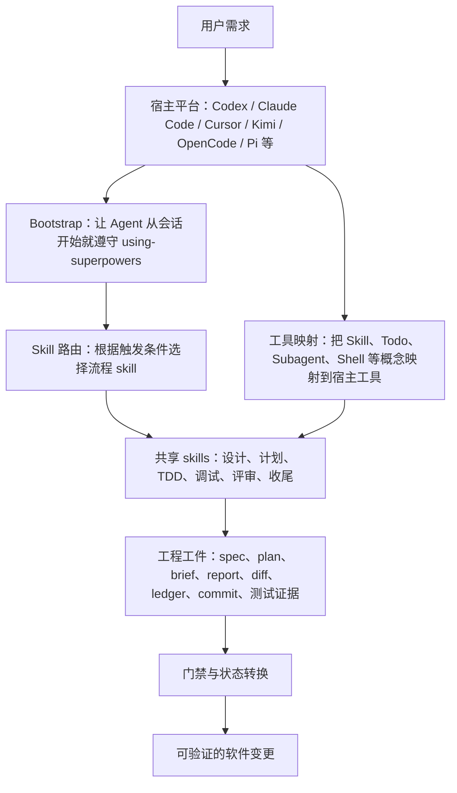
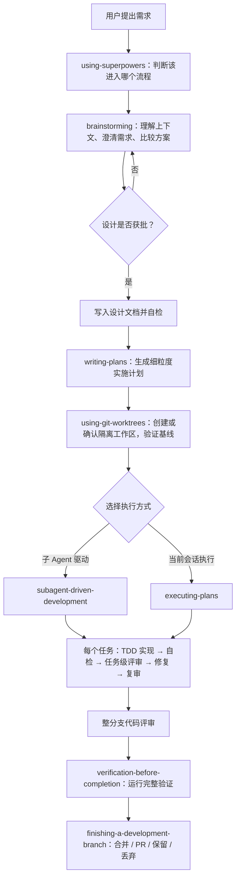
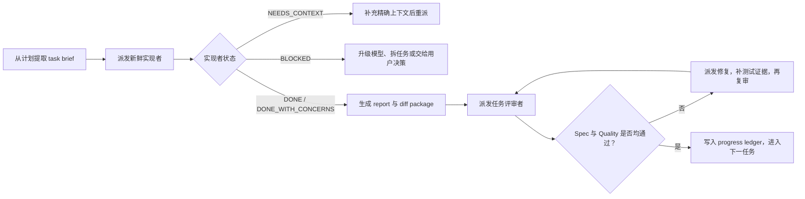

# 讲透 Superpowers：给 AI 编程 Agent 装上一套软件工程方法论

> 本文基于 Superpowers `v6.1.1`、提交 `d884ae0`（2026-07-02）整理。分析对象为本地开源仓库 `F:\AIProject\webArticle\01superpowers\superpowers`。

## 引言：AI 会写代码，但不天然会做软件工程

今天的 AI 编程工具已经能完成相当复杂的工作：理解代码、生成页面、补测试、修复报错、重构模块，甚至独立完成一个小型项目。

问题在于，“会写代码”和“能稳定地交付软件”不是一回事。

大语言模型擅长根据当前上下文预测下一段最合理的内容。用户说“加一个登录功能”，模型最自然的反应是搜索几个文件，然后马上开始改代码。这种即时行动看起来效率很高，却经常暴露出一组反复出现的问题。

### 1. 过早进入实现

需求还没有说清楚，AI 就开始选技术、建文件、写接口。等用户发现双方理解不同，代码已经写了一大半。

这不是编码能力不足，而是缺少“设计批准之前不能实现”的流程门禁。

### 2. 用猜测代替调查

遇到测试失败或线上 Bug 时，AI 很容易根据错误表象直接提出修改：改一个条件、加一个判空、延长一个超时时间，然后运行测试看看。

如果没修好，就继续叠加第二个、第三个补丁。最终可能把症状压下去了，却没有找到坏数据从哪里进入系统、哪个组件边界真正失效。

### 3. 测试沦为事后证明

AI 常见的做法是先写实现，再补一组能够通过的测试。这可以提高覆盖率，却无法证明测试真的能捕获缺陷。

一个从未失败过的测试，可能只是在重复实现细节，甚至只是验证 mock 按预期被调用。

### 4. 上下文越长，执行越容易漂移

在长任务中，需求、讨论、日志、代码片段、评审意见会不断进入同一个上下文。模型既要记住总体目标，又要处理当前细节，还要区分哪些决定已经过期。

随着上下文膨胀，重复工作、遗漏约束、误读计划和“顺手多做一点”的概率都会增加。

### 5. 把“我改了”误当成“已经完成”

代码发生变化，不等于 Bug 已修复；子 Agent 报告成功，不等于实现正确；局部测试通过，也不等于完整构建能够通过。

AI 很容易根据自己的意图和局部迹象给出“已经完成”的结论，而不是根据新鲜、完整、可复查的证据下结论。

### 6. 多 Agent 不等于自动获得团队协作

把任务丢给多个 Agent 只能带来并发能力，不能自动带来工程秩序。如果任务边界不清、上下文随意继承、多人同时修改共享文件、评审者相信实现者的自述，多 Agent 反而会放大混乱。

这些问题有一个共同点：它们不是“模型不会写某段代码”，而是“模型缺少稳定的软件开发过程”。Superpowers 正是从这里切入。

## Superpowers 到底是什么

Superpowers 对自己的定义是：一套建立在可组合 skills 之上的完整软件开发方法论。

它不是新的大模型，不是 IDE，也不是代码生成器。它更像安装在 AI 编程 Agent 上的一套“工程行为操作系统”：

- 用 `brainstorming` 约束需求与设计阶段；
- 用 `writing-plans` 把设计编译成可执行计划；
- 用 `using-git-worktrees` 隔离工作区；
- 用 `test-driven-development` 约束实现顺序；
- 用 `systematic-debugging` 约束排错方式；
- 用 `subagent-driven-development` 组织实现者和评审者；
- 用 `verification-before-completion` 阻止没有证据的完成声明；
- 用 `finishing-a-development-branch` 管理合并、PR、保留和丢弃。

因此，Superpowers 的价值不是让模型“知道更多”，而是让模型在正确的时间进入正确的工作状态，并且不能轻易跳过关键步骤。

可以把它概括为一句话：

> Superpowers 不直接提升模型智力，而是通过流程、门禁、工件和证据，降低模型犯错的自由度。

## 它背后的思想理念

### 1. 先定义问题，再生成答案

普通 AI 工作流通常是：用户描述一个目标，模型立即生成解决方案。

Superpowers 把中间缺失的部分补了回来：先理解项目，再澄清目的、约束和成功标准，然后比较方案，形成设计，获得批准，最后才允许实现。

这背后的判断是：多数返工不是因为代码写得慢，而是因为一开始解决了错误的问题。

### 2. 系统化过程优于临场聪明

它不鼓励“我大概知道怎么做”，而强调可重复的步骤：

- 调试先收集证据，再形成单一假设；
- 开发先看到测试正确失败，再写最小实现；
- 评审先检查需求符合性，再检查代码质量；
- 完成前先运行能证明结论的命令。

模型偶尔可以靠灵感一次猜对，但工程系统不能建立在“这次应该能猜对”上。

### 3. 证据高于声明

Superpowers 反复强调一个原则：`Evidence before claims`，先有证据，再做声明。

“我已经实现了”只是实现者的自述；“测试刚刚以 0 失败退出”“完整 diff 已被独立评审”“需求逐项核对通过”，才是工程证据。

### 4. 用小上下文换取高专注度

Superpowers 不希望每个子 Agent 继承整个会话。它要求控制者为任务构造最小、精确、可执行的上下文：任务 brief、必要接口、全局约束和工作目录。

这是一种主动的上下文工程：不是把信息越塞越多，而是让不同角色只看到完成当前职责所需的信息。

### 5. 用工件传递状态，而不是依赖聊天记忆

它把重要信息写入文件和 Git 历史：

- 设计文档保存“为什么这样做”；
- 实现计划保存“具体怎么做”；
- task brief 保存“当前子任务做什么”；
- report 保存“实现者做了什么、如何测试”；
- diff package 保存“评审者应该检查什么”；
- progress ledger 保存“哪些任务已经完成”；
- commit 保存可恢复、可审计的变更边界。

聊天上下文可能被压缩或遗忘，工件不会。这也是 Superpowers 能持续执行较长任务的重要原因。

### 6. 把 skill 当作代码，而不是普通文档

在 Superpowers 看来，skill 会改变 Agent 行为，因此它本质上是一段“行为程序”。修改 skill 不能只靠文字审校，而要像代码一样做 RED-GREEN-REFACTOR：

1. 先构造没有该 skill 时会失败的压力场景；
2. 记录 Agent 的真实逃避理由；
3. 编写最小规则纠正这些失败；
4. 重跑场景，验证行为改变；
5. 针对新出现的漏洞继续迭代。

这解释了为什么仓库中的 skill 经常使用强硬语言、Iron Law、Red Flags 和 Rationalization 表格。它们不是文风装饰，而是针对模型已观察到的逃避模式设计的行为约束。

## 总体架构：共享方法论，加一层平台适配

Superpowers 的架构可以分为四层。



### 第一层：共享 skill 内容

核心逻辑都在 `skills/*/SKILL.md`。当前版本共有 14 个核心 skill，所有平台尽量共享同一份内容，不为某个平台重写方法论。

### 第二层：Bootstrap

仅仅把 skill 文件安装到磁盘上没有意义。Agent 必须从会话开始就知道：先判断是否有适用 skill，再采取行动。

这个入口就是 `using-superpowers`。它规定，只要有很小概率某个 skill 适用，也要先加载；流程型 skill 优先于具体实现型 skill；用户的直接指令又高于 skill。

不同宿主用不同方式注入 bootstrap：

| 平台 | 启动方式 |
| --- | --- |
| Claude Code | `SessionStart` shell hook 读取 `using-superpowers/SKILL.md`，注入 `additionalContext` |
| Cursor | 复用 shell hook，但使用 Cursor 所需的 JSON 字段 |
| Copilot CLI | 使用顶层 `additionalContext` |
| Kimi Code | manifest 中声明 `sessionStart.skill = using-superpowers` |
| Gemini CLI | 通过 `GEMINI.md` 引入 bootstrap 和工具映射 |
| OpenCode | JS 插件注册 skills 路径，并把 bootstrap 插入首条用户消息 |
| Pi | TypeScript 扩展在会话开始和上下文压缩后重新注入 bootstrap |
| Codex | 依赖原生 skill discovery；manifest 明确写空 `hooks`，避免误加载其他平台的 SessionStart hook |

这里有一个很重要的工程细节：OpenCode 和 Pi 故意把 bootstrap 注入为用户消息，而不是额外系统消息，以减少每轮重复的 token 开销，并避开部分模型对多个 system message 的兼容问题。它们还实现了缓存和去重，防止同一会话反复读文件、重复注入。

### 第三层：工具映射

skill 描述的是动作，例如“创建 todo”“派发子 Agent”“调用 skill”“运行 shell”。不同平台的工具名和能力不同，所以平台适配层负责翻译，而不是修改 skill 本体。

这让 Superpowers 保持了一种很干净的边界：

> 方法论保持平台中立，适配器只解决发现、注入和工具名差异。

### 第四层：工程工件与门禁

Superpowers 的核心不只是调用顺序，更是一组状态转换条件：

- 没有用户批准的设计，不能进入实现计划；
- 没有计划，不能进入计划执行模式；
- 没有正确失败的测试，不能写生产代码；
- 没有根因调查，不能提出修复；
- 评审存在 Critical/Important 问题，不能进入下一任务；
- 没有新鲜验证结果，不能声称完成；
- 测试未通过，不能提供合并或 PR 选项。

从这个角度看，Superpowers 本质上是一台由自然语言规则实现的软件开发状态机。

## 一次完整任务是怎样流转的



这条主流程并不覆盖所有情况。遇到 Bug 时，`systematic-debugging` 会在修复前接管；遇到多个相互独立的问题时，`dispatching-parallel-agents` 可以并行调查；收到评审意见时，`receiving-code-review` 会约束反馈处理方式。

## 14 个核心 skill 的内部逻辑

### 1. using-superpowers：整个系统的总路由器

它是 Superpowers 的启动 skill，本身不负责写代码，而是改变 Agent 的默认决策顺序。

内部逻辑可以简化为：

1. 在任何回复、提问、搜索文件或执行命令之前，先判断是否存在适用 skill；
2. 只要存在很小的适用概率，就先加载再判断；
3. 多个 skill 同时适用时，先使用决定“怎么工作”的流程 skill，再使用具体实现 skill；
4. 用户明确要求跳过某个流程时，服从用户，因为用户指令优先；
5. 如果是已经被派发的具体子 Agent，则通过 `<SUBAGENT-STOP>` 避免重复启动整套总流程。

它还列出一组典型的模型自我辩解，例如“这只是一个简单问题”“我先快速看一下文件”“这个 skill 太重了”。这些句子相当于运行时断言：一旦 Agent 产生类似想法，就应该停止当前动作，回到 skill 检查。

### 2. brainstorming：把模糊想法编译成获批设计

`brainstorming` 处理所有创造性工作。它最核心的规则是 Hard Gate：设计展示并获得用户批准之前，不得写代码、搭脚手架或调用实现型 skill。

其内部流程是：

1. 先读取项目结构、文档和近期提交；
2. 判断需求是否过大，必要时先拆成多个可独立交付的子项目；
3. 一次只问一个问题，聚焦目的、约束和成功标准；
4. 给出 2～3 种方案、取舍和明确推荐；
5. 分段呈现架构、组件、数据流、错误处理和测试设计；
6. 每段获得确认，未确认就继续修改；
7. 把设计写入 `docs/superpowers/specs/YYYY-MM-DD-<topic>-design.md`；
8. 检查占位符、矛盾、范围和歧义；
9. 让用户审阅落盘后的 spec；
10. 唯一允许的下一步是 `writing-plans`。

它并不是追求冗长设计，而是强制暴露隐含假设。简单任务可以只有几句话的设计，但不能完全没有设计。

仓库还为它提供了可选的 Visual Companion：当布局、架构图或视觉方案确实“看比读更清楚”时，可以启动本地浏览器辅助展示；纯文本需求问题仍然留在对话中。

### 3. writing-plans：把设计编译成可机械执行的计划

如果说 brainstorming 产出的是“做什么和为什么”，writing-plans 产出的就是“逐步怎么做”。

计划假定执行者对项目几乎一无所知，因此必须包含：

- 精确文件路径；
- 要创建、修改和测试的文件；
- 任务之间的输入输出接口；
- 完整代码或明确修改内容；
- 精确命令和预期结果；
- RED、GREEN、REFACTOR 顺序；
- 每个小任务结束时的提交动作。

它对任务粒度有明确判断：一个任务应该是能独立完成一次测试循环、也值得独立评审的最小交付单元，而不是把脚手架、配置、文档机械拆成大量没有独立价值的小项。

计划完成后还要做三项自检：需求覆盖、占位符扫描、跨任务类型和接口一致性。最后让用户在“子 Agent 驱动”和“当前会话执行”之间选择。

### 4. using-git-worktrees：在实现前建立隔离环境

这个 skill 的核心不是“总要创建 worktree”，而是“先识别宿主已经提供的隔离，再选择最合适的机制”。

其顺序是：

1. 比较 Git 的 `git-dir` 和 `git-common-dir`，判断当前是否已经处于 linked worktree；
2. 排除 submodule 被误判为 worktree；
3. 如果已有隔离，直接复用；
4. 如果宿主提供原生 worktree 工具，优先使用原生工具；
5. 只有没有原生工具时，才回退到 `git worktree add`；
6. 对项目内 `.worktrees/` 目录先验证已被 `.gitignore` 忽略；
7. 自动识别 Node、Rust、Python、Go 等项目并安装依赖；
8. 运行基线测试，确认开始实现前仓库是干净的。

这个 skill 解决的是归因问题：如果实现后测试失败，必须知道失败是新引入的，而不是原本就存在。

### 5. subagent-driven-development：控制者、实现者、评审者三权分立

这是 Superpowers 最有代表性的 skill，也是长任务自动执行的核心。

它不是简单地“每个任务派一个 Agent”，而是建立了三类角色：

- 控制者：理解整体计划、切分上下文、调度任务、维护状态；
- 实现者：只负责一个 task，实施、测试、提交和自检；
- 评审者：不相信实现者的自述，根据任务 brief（摘要）、报告和 diff （差异）独立给出结论。

每个任务的执行循环如下：



这里有几个关键设计。

第一，实现任务通常顺序执行，而不是让多个实现者同时修改共享工作区。并行只适用于真正独立、不会共享状态的问题。

第二，子 Agent 不继承整个会话历史。控制者使用 `task-brief` 脚本从计划中提取当前任务，使用 report 文件保存实现细节，使用 `review-package` 生成包含提交列表、stat 和完整 diff 的评审包。大块内容通过文件交接，而不是反复粘贴进主上下文。

第三，任务级评审同时给出两个门禁结论：需求是否符合，以及代码质量是否通过。只有两个结论都通过，任务才能完成。

第四，`.superpowers/sdd/progress.md` 充当持久化进度账本。即使会话上下文被压缩，控制者也可以根据账本和 Git 历史恢复位置，避免重复派发已经完成的任务。

第五，它明确要求根据任务复杂度选择模型。机械、单文件、计划中已有完整代码的任务可以使用较便宜模型；多文件集成、架构判断和最终整分支评审使用更强模型。这是在质量、成本和轮次之间做工程权衡。

### 6. executing-plans：没有子 Agent 时的顺序执行器

`executing-plans` 是较轻的执行路径，适用于已有书面计划，但无法或不打算使用子 Agent 的情况。

它先完整审查计划，有关键缺口就停止并询问；没有问题则把计划转为 todos，逐任务执行、运行指定验证、更新状态。全部任务完成后，必须进入 `finishing-a-development-branch`。

它的优点是简单、兼容性强，缺点是设计、实现、检查都由同一个上下文完成，缺少新鲜视角和角色隔离。因此 Superpowers 明确认为：支持子 Agent 的平台上，优先使用 subagent-driven-development。

### 7. dispatching-parallel-agents：只并行真正独立的问题

这个 skill 用于同时存在多个独立故障域的情况，例如三个不同测试文件分别暴露不同根因。

内部判断有两道门：

1. 问题是否真的独立，修复一个不会影响另一个；
2. 多个 Agent 是否不会编辑同一共享状态或互相干扰。

满足条件后，每个 Agent 获得一个聚焦、完整、有约束、有明确输出格式的任务，并在同一轮同时派发。返回后，控制者仍需检查冲突并运行完整测试套件。

它特别反对把探索性调试盲目并行化，因为当根因尚不清楚时，看似多个问题可能只是同一个上游故障的不同症状。

### 8. test-driven-development：用失败测试定义实现边界

TDD skill 的 Iron Law 是：没有先失败的测试，就不能写生产代码。

它执行严格的 RED-GREEN-REFACTOR：

1. RED：写一个只描述单一行为的最小测试；
2. Verify RED：确认测试是“因为功能缺失而正确失败”，不是语法错误或环境错误；
3. GREEN：只写让当前测试通过的最小代码；
4. Verify GREEN：确认当前测试和其他测试全部通过，输出没有警告和噪音；
5. REFACTOR：只在绿色状态下清理重复、改名和提取结构；
6. 对下一个行为重复循环。

最强硬的一条规则是：如果先写了实现，应该删除实现并从测试重新开始，不能把已有代码留作“参考”。这是为了消除事后测试天然受到实现偏见影响的问题。

它也把“测试很难写”视为设计信号：如果必须 mock 一切、测试准备极其复杂，通常说明模块耦合过高或接口不清晰。

### 9. systematic-debugging：用科学方法替代试错式修复

systematic-debugging 规定，没有完成根因调查之前，不能提出修复。

它分成四个阶段：

1. 根因调查：完整读错误、稳定复现、检查近期变化、在组件边界收集证据、沿调用链反向追踪坏数据；
2. 模式分析：寻找同仓库中的正常实现，与参考逐项比较，理解依赖和假设；
3. 假设验证：一次只提出一个具体假设，用最小改动只验证一个变量；
4. 实施修复：先写能复现问题的失败测试，再做单一根因修复，并完成回归验证。

如果连续三次修复都失败，它要求停止继续打补丁，转而和用户讨论架构是否本身有问题。这条规则很重要，因为连续失败往往意味着共享状态、边界或抽象方向错误，而不是还差“最后一个小修复”。

配套资料还包含三种实用技术：沿调用栈反向追踪根因、根因确认后做纵深防御、用条件等待替代随意 sleep 和固定超时。

### 10. requesting-code-review：把评审变成明确门禁

这个 skill 规定在以下时点必须评审：子 Agent 开发中的每个任务之后、重大功能完成后、合并到主分支之前。

评审者获得的是明确的需求、基准 SHA、结束 SHA 和代码差异，而不是整个开发聊天记录。评审输出按 Critical（关键）、Important（重要）、Minor（次要） 分级，并给出是否可合并的明确结论。

Critical 必须立即修复，Important 必须在继续前修复，Minor 可以记录后处理。评审者如果错误，实现者可以用代码和测试进行技术性反驳，而不是机械服从。

### 11. receiving-code-review：防止“礼貌性服从”破坏代码

AI 很容易对评审意见回复“你完全正确”，然后立即照做。这个 skill 明确禁止这种表演式同意。

处理顺序是：完整阅读、用自己的话理解、对照代码验证、评估是否适合当前项目、技术回应、逐项实现并测试。

对用户直接给出的反馈保持信任，但范围不清仍要确认；对外部评审保持审慎，检查它是否破坏兼容性、违反 YAGNI、忽略现有架构或与用户既有决定冲突。

它强调：评审是技术输入，不是命令。正确的反馈要落实，错误的反馈要有证据地反驳。

### 12. verification-before-completion：完成声明的证据闸门

这是 Superpowers 最短但最关键的 skill 之一。

它把任何完成声明都视为一个需要证明的命题：

1. 先确定什么命令可以证明该命题；
2. 在当前阶段重新运行完整命令；
3. 阅读完整输出、退出码和失败数量；
4. 输出不支持结论时，只报告真实状态；
5. 输出支持结论后，才能说“测试通过”“构建成功”“Bug 已修复”。

历史运行结果、“应该能通过”、linter 通过、子 Agent 报告成功，都不能替代当前证据。对于回归测试，甚至要验证修复存在时通过、临时撤销修复后失败、恢复修复后再次通过。

### 13. finishing-a-development-branch：把工程收尾也纳入流程

实现完成不代表分支处理完成。这个 skill 负责最后的交付决策。

它先重新运行测试，然后识别当前是在普通仓库、命名 worktree，还是宿主管理的 detached HEAD，再确定基础分支，最后给出结构化选项：

1. 本地合并；
2. 推送并创建 PR；
3. 保留分支；
4. 丢弃工作。

detached HEAD 环境不能直接本地合并，因此只显示三项。

丢弃必须要求用户输入明确确认；创建 PR 后保留 worktree，方便处理后续评审；只有本地合并或丢弃时才清理自己创建的 worktree；宿主创建的隔离空间不能擅自删除。

这体现了 Superpowers 的完整性：它不只关心代码生成，也关心变更如何安全进入版本控制生命周期。

### 14. writing-skills：用 TDD 开发 Agent 的行为程序

这个元 skill 用来创建、修改和验证其他 skill。

它将 skill 分为 technique、pattern 和 reference，并强调 description 只描述“何时触发”，不能概括完整流程。原因是 Agent 可能把 description 当成捷径，看完一句摘要就不再读取正文，导致关键步骤丢失。

它还提出 Skill Discovery Optimization：通过清晰触发条件、症状关键词、主动式命名和扁平命名空间，让未来 Agent 能在正确场景找到 skill。

最核心的仍然是 TDD 映射：

| 软件 TDD | Skill 开发 |
| --- | --- |
| 测试用例 | 带压力的 Agent 场景 |
| RED | 没有 skill 时 Agent 违反规则 |
| 生产代码 | `SKILL.md` |
| GREEN | 加载 skill 后 Agent 正确执行 |
| REFACTOR | 针对新借口堵住规则漏洞 |

它还区分两类提示词问题：如果 Agent 明知规则却在压力下跳过，适合使用禁止语句、Red Flags 和反驳表；如果 Agent 愿意执行但输出形态不对，应该提供正向结构和明确模板，过多禁止语句反而可能强化错误输出。

## Superpowers 真正精巧的内部机制

逐个看 skill 容易把它理解成 14 份开发规范。真正把它们连成系统的，是下面几种机制。

### 1. Skill 路由不是菜单，而是触发器网络

每个 `SKILL.md` 的 YAML frontmatter 都有 `name` 和 `description`。description 尽量只写适用条件，例如“实现功能或修复 Bug、且尚未写生产代码时使用”。

Agent 先根据这些条件判断应该加载哪个 skill，再读取完整正文。skill 之间通过 REQUIRED SUB-SKILL、REQUIRED BACKGROUND 和明确终态建立跳转关系，于是形成一张流程图，而不是互不相关的文档列表。

### 2. 门禁让流程从“建议”变成“状态机”

很多 AI 提示词写的是“最好先测试”“建议先确认需求”。模型在时间压力下很容易跳过建议。

Superpowers 使用 Hard Gate、Iron Law、STOP 条件、禁止的下一步和明确终态，把规则写成类似程序断言的形式。它还把常见自我辩解提前列出，减少模型重新解释规则的空间。

### 3. 工件构成可审计的证据链

一次完整交付中，信息不是只存在于聊天里，而是形成连续链条：

```text
用户意图
  → 获批设计 spec
  → 详细实现 plan
  → 单任务 brief
  → 实现 report + TDD 证据
  → Git commit + diff package
  → 任务级 review verdict
  → 全分支 review
  → 最新完整验证输出
  → 合并或 PR 决策
```

任何一层都可以追溯上一层，评审者也能判断实现是否偏离需求。

### 4. 角色隔离降低自我确认偏差

同一个 Agent 设计、实现、测试、评审自己的工作，很容易把“我本来想这样做”误当成“代码确实这样做了”。

Superpowers 通过控制者、实现者和评审者分离，让每个角色拥有不同信息和责任。评审模板甚至明确写着“不要相信实现报告”，要求根据 diff 独立验证。

### 5. 上下文压缩被当成正常故障模式

很多 Agent 工作流默认聊天记录会一直完整存在。Superpowers 直接承认上下文会膨胀、压缩甚至遗忘，因此把进度、任务文本、报告和 diff 全部文件化。

`task-brief`、`review-package` 和 progress ledger 不是辅助小工具，而是长时间自动执行能够恢复的基础设施。

### 6. 测试分成“代码是否工作”和“Agent 是否守规矩”

仓库的 `tests/` 检查非 LLM 代码，例如 hook 输出、OpenCode 插件加载、bootstrap 缓存、Kimi manifest、brainstorm server 和打包脚本。

真正的 skill 行为则需要 eval：驱动真实模型会话，在时间压力、沉没成本、权威指令和上下文干扰下观察 Agent 是否仍遵守规则。也就是说，Superpowers 同时测试软件接线和模型行为。

## Superpowers 能做什么

它最适合以下类型的工作：

- 从模糊想法开始的新功能或新项目；
- 涉及多个文件、多个步骤的持续开发任务；
- 需要严格测试和可回归保障的改动；
- 难以定位的 Bug、构建失败、集成问题和偶发测试；
- 可以拆成多个独立任务的工程计划；
- 需要多个 Agent 分工、评审和长期执行的场景；
- 需要在 Claude Code、Codex、Cursor、Kimi、OpenCode、Pi 等宿主之间复用同一套方法论的团队。

它不能替代的东西同样明确：

- 它不能替代业务领域知识；
- 不能保证设计选择本身一定正确；
- 不能弥补缺失的测试环境、权限、依赖或真实用户反馈；
- 不能让完全不可拆分的任务天然并行；
- 不能突破宿主平台没有提供的能力，例如缺少子 Agent 工具时，只能降级为单会话执行；
- 不能消除模型错误，只能通过流程显著降低错误概率并提高可发现性。

## 优点：为什么这套方法有效

### 1. 把 AI 的弱点转化为流程约束

模型容易冲动实现，就加设计门禁；容易猜测修复，就强制根因调查；容易自信宣布完成，就要求新鲜验证；容易上下文漂移，就把状态外置到文件。

这些规则不是抽象最佳实践，而是逐项对应 Agent 的典型失败模式。

### 2. 交付过程可解释、可追溯

设计、计划、实现、测试、评审和收尾都有明确产物。即使最终代码有问题，也容易定位是哪一层判断失效，而不是只能回看一段漫长聊天。

### 3. 多 Agent 协作有了工程边界

新鲜上下文、明确任务 brief、实现报告、独立评审、严重级别和复审循环，让多 Agent 更像一个有流程的开发团队，而不是多个模型同时改文件。

### 4. 强化测试与验证的可信度

它不满足于“有测试”，而要求见证失败、最小实现、完整通过和无噪音输出；不满足于“Agent 说完成”，而要求独立检查 diff 和运行验证命令。

### 5. 跨平台设计比较干净

核心 skill 保持共享，平台差异集中在 bootstrap、manifest、hook 和工具映射里。新增宿主原则上不需要修改方法论正文。

### 6. 能支持长时间、可恢复的自动执行

文件化交接和进度账本让系统不完全依赖主会话记忆，适合多任务、长链路的自动开发。

## 缺点与代价：Superpowers 不是免费的午餐

### 1. 对小任务可能显得过重

一个非常明确的文案修改或单行配置变更，如果仍完整经历设计、计划、worktree、TDD、评审和收尾，流程成本可能高于实现成本。

Superpowers 的回答是“简单任务也会隐藏假设，设计可以很短但不能没有”。这在高可靠场景合理，但在探索性原型或低风险修改中，使用者可能觉得仪式感过强。

### 2. 强纪律带来一定僵化

“先写了实现就删除重来”“没有失败测试不能写生产代码”“三个修复失败后必须讨论架构”等规则有助于阻止模型走捷径，但并非所有团队都接受如此严格的 TDD。

生成代码、一次性脚本、实验性 Spike、难以自动化测试的外部集成，可能需要用户明确授权例外。

### 3. Token、时间和模型成本更高

一个任务可能需要实现者、任务评审者、修复者、复审者和最终整分支评审者。高质量来自更多检查，也意味着更多模型调用和更长墙钟时间。

仓库已经通过任务 brief、diff 文件、缓存、去重和模型分级降低成本，但无法消除流程本身的成本。

### 4. 效果依赖宿主能力

最完整的体验需要原生 skill 发现、会话启动注入、任务列表、子 Agent、worktree 和文件工具。宿主缺少某项能力时只能映射或降级。

尤其是 bootstrap，如果平台不能保证会话开始时加载，skills 即使安装在磁盘上也可能成为“死资源”。

### 5. 自然语言门禁仍不是形式化验证

Hard Gate 和 Iron Law 最终仍由大模型解释执行。它们比普通提示词强，但不等同于编译器、权限系统或 CI 的硬性限制。模型仍可能漏触发、误判适用范围或在复杂指令冲突中选择错误路径。

因此，关键规则最好继续由真实工具兜底，例如分支保护、CI、测试覆盖阈值、静态分析和权限控制。

### 6. 计划质量会向下游放大

Superpowers 擅长让执行者忠实地实施计划。如果最初的 spec 或 plan 本身有错误，后续任务可能高质量地实现错误设计。

它通过用户批准、spec 自检、计划自检、任务评审和整分支评审降低这种风险，但不能替代真实业务验证和架构判断。

### 7. 过度模板化可能抑制探索

强制把工作快速收敛到 spec、任务和验收条件，有利于交付，却可能不适合尚处于研究阶段的问题。真正未知的技术方向有时需要先做可丢弃实验，再决定正式设计。

这类场景最好明确告诉 Agent 当前是探索性原型，并约定哪些步骤可以暂时例外、哪些成果不能直接进入生产。

## 如何正确理解和使用 Superpowers

最容易犯的误解，是把它当成“安装后代码质量自动提高”的技能包。

更准确的理解是：它提供一套默认严格的软件工程协议。要发挥价值，需要满足三个条件：

1. 宿主能在会话开始可靠加载 `using-superpowers`；
2. 用户愿意在设计批准、计划选择和分支收尾等关键节点参与决策；
3. 项目本身具备可运行的测试、构建和版本控制基础。

使用时也不必迷信所有流程长度固定不变。设计章节、计划粒度和评审深度可以按风险缩放，但关键证据不能被语言上的“简化”替代：

- 低风险任务可以有很短的设计，但仍应明确目标和成功标准；
- 小改动可以只运行聚焦测试，但声称整个项目通过时必须运行完整验证；
- 没有子 Agent 可以降级执行，但不能把自述当成独立评审；
- 探索性代码可以申请不走严格 TDD，但必须明确它是可丢弃原型，而不是生产实现。

## 总结

Superpowers 最重要的贡献，不是发明了 brainstorming、TDD、调试或代码评审。这些实践在软件工程中早已存在。

它真正做的事情，是把这些实践重新编码成适合 AI Agent 执行的行为模块，并通过自动触发、强制门禁、角色隔离、文件化交接、独立评审和新鲜证据，把它们连接成一条完整开发流水线。

传统提示词往往告诉 AI：“请认真一点、先思考、记得测试。”Superpowers 则进一步追问：

- 什么情况下必须停止实现？
- 什么证据出现后才能进入下一状态？
- 哪些信息应该交给哪个角色？
- 怎样防止模型为跳过规则寻找借口？
- 上下文丢失后如何恢复？
- 如何证明 Agent 真的遵守了流程？

这也是它最值得借鉴的地方：未来 AI 开发工具的竞争，未必只是谁的模型更聪明，还包括谁能把模型组织成一个更可靠、更可验证、更像工程团队的系统。

Superpowers 给出的答案是：不要只给 Agent 更多能力，还要给它边界、状态、证据和纪律。

## 主要源码阅读入口

- `README.md`：项目定位、基础工作流与设计哲学
- `skills/using-superpowers/SKILL.md`：系统启动和 skill 路由规则
- `skills/brainstorming/SKILL.md`：需求澄清与设计门禁
- `skills/writing-plans/SKILL.md`：实现计划格式和任务粒度
- `skills/subagent-driven-development/SKILL.md`：多 Agent 执行、评审与持久化状态
- `skills/test-driven-development/SKILL.md`：严格 RED-GREEN-REFACTOR
- `skills/systematic-debugging/SKILL.md`：四阶段根因调试方法
- `skills/verification-before-completion/SKILL.md`：完成声明的证据规则
- `skills/writing-skills/SKILL.md`：skill 的 TDD 化开发方法
- `hooks/session-start`：Claude Code、Cursor、Copilot CLI 的 bootstrap 注入
- `.opencode/plugins/superpowers.js`：OpenCode 的 skill 注册、缓存、去重和消息注入
- `.pi/extensions/superpowers.ts`：Pi 的生命周期与上下文压缩后重新注入
- `docs/porting-to-a-new-harness.md`：跨宿主架构与接入原则
- `docs/testing.md`：插件测试与真实 LLM 行为评估的分层
